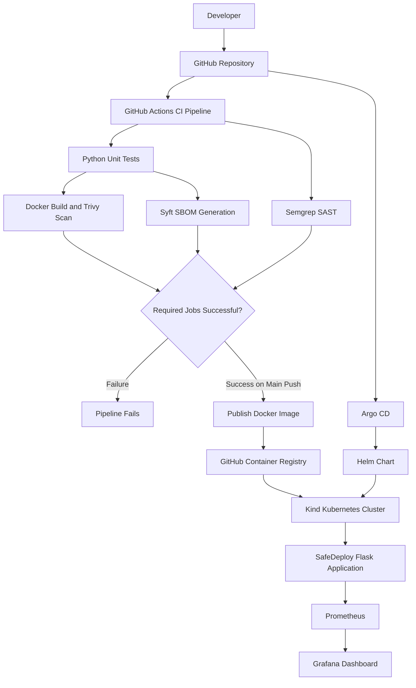

# SafeDeploy – Secure CI/CD and GitOps-Based Kubernetes Deployment Platform


## 1. Project Overview

**SafeDeploy** is a hands-on DevSecOps and GitOps project that demonstrates an automated workflow for building, testing, securing, packaging, deploying, and monitoring a containerized Python application.

The project integrates GitHub Actions for Continuous Integration (CI), Semgrep for source-code security analysis, Trivy for container vulnerability scanning, and Syft for Software Bill of Materials (SBOM) generation.

Docker images are published to GitHub Container Registry (GHCR). The application is deployed to a local Kubernetes cluster using Helm, while Argo CD implements GitOps-based continuous deployment by synchronizing Kubernetes resources with the configuration stored in Git.

Prometheus collects application metrics, and Grafana provides dashboards for monitoring application availability, HTTP traffic, and response time.

The project uses Kind (Kubernetes in Docker) to provide a lightweight Kubernetes environment without requiring a managed cloud Kubernetes service.

### Project Objectives

- Automate Python application testing using GitHub Actions.
- Build and package applications using Docker.
- Integrate DevSecOps security scanning into the CI pipeline.
- Generate an SBOM to identify container dependencies.
- Publish container images to GitHub Container Registry.
- Deploy applications to Kubernetes using Helm.
- Implement GitOps-based synchronization using Argo CD.
- Monitor application health and performance using Prometheus and Grafana.
- Maintain deployment configurations and application source code in Git.

## 2. Architecture



### Architecture Workflow

1. Developer pushes application or configuration changes to GitHub.
2. GitHub Actions starts the CI pipeline.
3. Python unit tests validate application functionality.
4. Semgrep analyzes application source code for security issues.
5. Docker builds the application image.
6. Trivy scans the image for known vulnerabilities.
7. Syft generates a CycloneDX SBOM.
8. When all required jobs succeed on a push to the main branch, the image is published to GHCR.
9. Argo CD monitors the Git repository and synchronizes the Helm-based Kubernetes configuration.
10. Kubernetes runs the SafeDeploy application.
11. Prometheus collects application metrics.
12. Grafana visualizes the collected metrics.

**Important:** Image publishing and GitOps synchronization are separate workflows. Argo CD manages the Kubernetes configuration stored in Git; the current project does not implement automatic image-tag updates in the Helm chart.

## 3. Technology Stack

| Category | Technologies |
|---|---|
| Programming Language | Python |
| Application Framework | Flask |
| Version Control | Git, GitHub |
| CI/CD | GitHub Actions |
| Containerization | Docker |
| Source Code Security | Semgrep |
| Container Security | Trivy |
| SBOM Generation | Syft |
| Container Registry | GitHub Container Registry |
| Container Orchestration | Kubernetes |
| Local Kubernetes | Kind |
| Kubernetes Packaging | Helm |
| GitOps | Argo CD |
| Metrics Collection | Prometheus |
| Visualization | Grafana |
| Environment | Linux, GitHub Codespaces |

## 4. Repository Structure

```text
safe-deploy/
│
├── .github/
│   └── workflows/
│       └── ci.yml
│
├── app/
│   └── app.py
│
├── tests/
│   └── test_app.py
│
├── k8s/
│   ├── deployment.yaml
│   └── service.yaml
│
├── helm/
│   └── safe-deploy/
│       ├── Chart.yaml
│       ├── values.yaml
│       └── templates/
│           ├── deployment.yaml
│           └── service.yaml
│
├── monitoring/
│   ├── prometheus.yml
│   ├── prometheus-k8s.yaml
│   └── grafana-k8s.yaml
│
├── Dockerfile
├── requirements.txt
├── kind-config.yaml
├── .dockerignore
├── .gitignore
└── README.md
```

## 5. Application Development – Flask

The application is developed using Python and Flask.

It exposes three HTTP endpoints:

| Endpoint | Description |
|---|---|
| `/` | Returns application information and running status |
| `/health` | Provides an application health-check response |
| `/metrics` | Exposes application metrics for Prometheus |

### Application Server

Gunicorn is used as the WSGI application server inside the Docker container.

### Application Dependencies

- Flask – Web application framework.
- Gunicorn – WSGI application server.
- prometheus-client – Prometheus metrics instrumentation.

Dependencies are maintained in `requirements.txt`.

### Run Unit Tests

```bash
python -m unittest discover -s tests -v
```

The test suite validates the application's home and health endpoints.

## 6. Docker Containerization

Docker is used to package the Flask application and its dependencies into a container image.

The Dockerfile uses:

- Python slim base image.
- Dependency installation through pip.
- Application source code copied into the image.
- Gunicorn as the application server.
- Port 5000 for application access.

### Build Docker Image

```bash
docker build -t safe-deploy:1.1 .
```

### Run Docker Container

```bash
docker run -d \
  --name safe-deploy-app \
  -p 5000:5000 \
  safe-deploy:1.1
```

### Verify Application

```bash
curl http://localhost:5000/
curl http://localhost:5000/health
curl http://localhost:5000/metrics
```

## 7. CI Pipeline – GitHub Actions

The CI workflow is implemented in:

```text
.github/workflows/ci.yml
```

The workflow runs on:

- Push events to the `main` branch.
- Pull requests targeting the `main` branch.

### CI Pipeline Jobs

#### Job 1: Python Unit Testing

- Checks out the repository.
- Sets up Python 3.12.
- Installs application dependencies.
- Executes Python unit tests.

Command:

```bash
python -m unittest discover -s tests -v
```

#### Job 2: Docker Build and Trivy Scan

Builds the Docker image using the current Git commit SHA as its image tag.

Trivy scans the image for:

- Operating system package vulnerabilities.
- Application library vulnerabilities.
- HIGH and CRITICAL severity findings.

Configuration:

- Vulnerability types: `os,library`
- Severity: `HIGH,CRITICAL`
- Ignore unfixed vulnerabilities: enabled.
- Exit code: `1`

A matching vulnerability causes the Trivy job to fail.

The Trivy report is uploaded as a GitHub Actions artifact with a retention period of 14 days when a report is available.

#### Job 3: Semgrep Source Code Security Scan

Semgrep performs Static Application Security Testing (SAST).

Command:

```bash
semgrep scan --config p/python --error app/
```

Purpose:

- Analyze Python source code.
- Identify potentially insecure coding patterns.
- Fail the job when findings meet Semgrep's error criteria.

#### Job 4: SBOM Generation Using Syft

Syft generates a Software Bill of Materials for the Docker image.

The generated SBOM uses:

```text
CycloneDX JSON
```

Output file:

```text
sbom.cyclonedx.json
```

The SBOM is uploaded as a GitHub Actions artifact.

Purpose:

- Identify software packages and dependencies.
- Improve software supply-chain visibility.
- Maintain an inventory of components included in the container image.

#### Job 5: Publish Image to GHCR

The publishing job depends on all four preceding jobs:

```yaml
needs: [test, docker-build, semgrep, sbom]
```

Publishing is restricted to pushes to the `main` branch.

The workflow:

1. Sets up Docker Buildx.
2. Authenticates with GitHub Container Registry.
3. Builds and pushes the Docker image.

Published image tags:

```text
ghcr.io/pooja-dhawale16/safe-deploy:latest
ghcr.io/pooja-dhawale16/safe-deploy:<commit-sha>
```

Authentication uses GitHub's automatically provided `GITHUB_TOKEN`.

### CI Pipeline Summary

| Job | Tool | Purpose |
|---|---|---|
| Python Tests | Python unittest | Application testing |
| Docker Build and Scan | Docker, Trivy | Image building and vulnerability scanning |
| Source Code Scan | Semgrep | SAST |
| SBOM Generation | Syft | Software dependency inventory |
| Image Publishing | Docker Buildx, GHCR | Container image distribution |

**Pipeline dependency:** The publishing job runs only when testing, Docker scanning, Semgrep, and SBOM generation have succeeded.

## 8. Container Registry – GitHub Container Registry

GitHub Container Registry (GHCR) is used to store and distribute Docker images.

Image repository:

```text
ghcr.io/pooja-dhawale16/safe-deploy
```

The CI workflow publishes two tags:

- `latest`
- Git commit SHA

The GHCR package is configured as public for this demonstration, allowing the Kubernetes cluster to pull the image without private registry credentials.

## 9. Kubernetes Deployment Using Kind

Kind is used to create a local Kubernetes cluster.

It runs Kubernetes nodes as Docker containers, providing a lightweight environment for testing Kubernetes deployments.

### Create Kubernetes Cluster

```bash
kind create cluster \
  --name safedeploy \
  --config kind-config.yaml \
  --wait 120s
```

### Verify Cluster

```bash
kubectl cluster-info
kubectl get nodes
```

### Load Local Docker Image into Kind

```bash
kind load docker-image safe-deploy:1.1 \
  --name safedeploy
```

### Kubernetes Resources

**Deployment**

- Manages application pods.
- Defines container image and replicas.
- Configures readiness and liveness probes.

**Service**

- Exposes the application inside the Kubernetes cluster.
- Uses NodePort for external access from the local cluster environment.

**Health Probes**

- Readiness probe checks whether the application is ready to receive traffic.
- Liveness probe checks whether the application is healthy.

### Verify Deployment

```bash
kubectl get nodes
kubectl get pods -n default
kubectl get deployments -n default
kubectl get services -n default
```

The application is deployed in the `default` namespace.

## 10. Helm – Kubernetes Package Management

Helm is used to package Kubernetes application configuration into a reusable chart.

Chart location:

```text
helm/safe-deploy/
```

### Chart Structure

| File | Purpose |
|---|---|
| `Chart.yaml` | Chart metadata |
| `values.yaml` | Configurable deployment values |
| `templates/deployment.yaml` | Kubernetes Deployment template |
| `templates/service.yaml` | Kubernetes Service template |

### Validate Helm Chart

```bash
helm lint helm/safe-deploy
```

### Render Kubernetes Manifests

```bash
helm template safe-deploy helm/safe-deploy
```

The Helm chart defines the desired Kubernetes configuration and is used by Argo CD to manage the application deployment.

## 11. GitOps – Argo CD

Argo CD is used to implement GitOps-based continuous deployment.

Git acts as the source of truth for the desired Kubernetes configuration.

Argo CD continuously monitors the configured repository and compares the desired state with the actual state of the Kubernetes cluster.

### Argo CD Application Configuration

| Configuration | Value |
|---|---|
| Repository | `https://github.com/pooja-dhawale16/safe-deploy` |
| Branch | `main` |
| Application path | `helm/safe-deploy` |
| Destination namespace | `default` |
| Sync policy | Automated |

### GitOps Workflow

1. Developer modifies the Helm chart configuration.
2. Changes are committed and pushed to GitHub.
3. Argo CD detects the updated Git revision.
4. Argo CD renders the Helm chart.
5. Argo CD compares the desired state with the actual cluster state.
6. Argo CD automatically synchronizes the changes.
7. Kubernetes reconciles the application resources.

### Automated Synchronization Verification

Automated synchronization was tested by changing the Helm replica count.

**Test 1: Scale application**

Changed:

```yaml
replicaCount: 2
```

After pushing the change to GitHub, Argo CD detected the updated configuration and automatically scaled the Kubernetes deployment to two replicas.

**Test 2: Restore application**

Changed:

```yaml
replicaCount: 1
```

After pushing the updated configuration, Argo CD automatically reconciled the deployment back to one replica.

This verified that automated GitOps synchronization was functioning.

### Useful Commands

```bash
argocd app get safe-deploy
```

```bash
kubectl get deployments -n default
```

```bash
kubectl get pods -n default
```

## 12. Monitoring – Prometheus and Grafana

Prometheus and Grafana are integrated to monitor the SafeDeploy application.

### Prometheus

Prometheus collects application metrics from the Flask application's `/metrics` endpoint.

Configuration files:

```text
monitoring/prometheus.yml
monitoring/prometheus-k8s.yaml
```

The Kubernetes Prometheus configuration uses a 15-second scrape interval.

Scrape target:

```yaml
scrape_configs:
  - job_name: "safedeploy"
    metrics_path: /metrics
    static_configs:
      - targets: ["safe-deploy:5000"]
```

Prometheus collects and stores time-series metrics.

### Application Metrics

The Flask application exposes:

**1. HTTP Request Counter**

```text
safedeploy_http_requests_total
```

Tracks HTTP request counts with labels for:

- HTTP method.
- Endpoint.
- HTTP status code.

**2. HTTP Request Duration Histogram**

```text
safedeploy_http_request_duration_seconds
```

Tracks request duration and provides histogram buckets for latency analysis.

Prometheus scraping requests are excluded from application request counting.

### Grafana

Grafana is used to visualize Prometheus metrics through a monitoring dashboard.

Kubernetes configuration:

```text
monitoring/grafana-k8s.yaml
```

The Prometheus data source is provisioned using the following internal service URL:

```text
http://prometheus:9090
```

Grafana credentials are stored in a Kubernetes Secret named:

```text
grafana-admin
```

The credentials are not stored in the Git repository.

### SafeDeploy Dashboard Panels

The dashboard includes four monitoring panels.

**1. Application Availability**

```promql
up{job="safedeploy"}
```

- `1` – Prometheus successfully scraped the application metrics endpoint.
- `0` – Prometheus could not successfully scrape the target.

**2. Total HTTP Requests**

```promql
sum(safedeploy_http_requests_total)
```

Displays the total number of HTTP requests recorded by the application.

**3. HTTP Requests Per Second**

```promql
sum(rate(safedeploy_http_requests_total[5m]))
```

Displays the average per-second request rate over a five-minute window.

**4. 95th Percentile Response Time**

```promql
histogram_quantile(
  0.95,
  sum by (le) (
    rate(safedeploy_http_request_duration_seconds_bucket[5m])
  )
)
```

Displays the estimated 95th percentile request duration.

This means approximately 95% of observed requests completed within the displayed duration.

### Monitoring Verification

Check Prometheus targets:

```bash
curl -s http://localhost:9090/api/v1/targets
```

Check application availability:

```bash
curl -s \
  'http://localhost:9090/api/v1/query?query=up'
```

### Access Grafana

Start port forwarding:

```bash
kubectl port-forward svc/grafana 3000:3000 -n default
```

Open:

```text
http://localhost:3000
```

For GitHub Codespaces, use the Ports tab and open forwarded port 3000 in the browser.

## 13. Useful Troubleshooting Commands

### Kubernetes

```bash
kubectl get nodes
kubectl get pods -n default
kubectl get deployments -n default
kubectl get services -n default
```

Inspect application logs:

```bash
kubectl logs deployment/safe-deploy -n default
```

Describe a pod:

```bash
kubectl describe pod <pod-name> -n default
```

### Docker

```bash
docker ps
docker images
docker logs <container-name>
```

### Helm

```bash
helm lint helm/safe-deploy
helm list -n default
```

### Argo CD

```bash
argocd app get safe-deploy
```

### Prometheus and Grafana

```bash
kubectl get pods -n default
kubectl logs deployment/prometheus -n default
kubectl logs deployment/grafana -n default
```

## 14. DevSecOps and Security Considerations

SafeDeploy integrates security practices into the application build and deployment workflow.

| Security Practice | Tool | Implementation |
|---|---|---|
| Static Application Security Testing | Semgrep | Python source-code analysis |
| Container Vulnerability Scanning | Trivy | OS and application library vulnerability checks |
| Software Bill of Materials | Syft | CycloneDX SBOM generation |
| Registry Access | GHCR | Container image storage |
| Credential Management | Kubernetes Secret | Grafana admin credentials |
| Application Health Checks | Kubernetes | Readiness and liveness probes |

**Security considerations:**

- Security scanning is integrated into CI rather than being treated as a separate manual activity.
- Trivy is configured to fail the job for matching HIGH and CRITICAL vulnerabilities.
- Semgrep uses error-based findings to determine job success.
- SBOM generation improves visibility into software dependencies.
- Secrets are maintained outside the Git repository.

The presence of security scanners does not guarantee that all vulnerabilities have been eliminated. Scan results should be reviewed and remediated.

## 15. Project Scope and Limitations

SafeDeploy currently demonstrates a local Kubernetes-based DevOps workflow.

### Implemented

- Flask application development.
- Docker containerization.
- Python unit testing.
- GitHub Actions CI automation.
- Semgrep source-code scanning.
- Trivy container vulnerability scanning.
- Syft SBOM generation.
- GHCR image publishing.
- Kind Kubernetes cluster.
- Helm-based application packaging.
- Argo CD automated GitOps synchronization.
- Prometheus metrics collection.
- Grafana monitoring dashboard.

### Not Currently Implemented

- Production AWS EKS deployment.
- Multi-cluster Kubernetes deployment.
- Production-grade persistent monitoring storage.
- High availability and disaster recovery.
- Image signing and verification.
- Automated image-tag updates in the Helm chart.
- Production-grade centralized secrets management.

These are possible future improvements, not completed project features.

## 16. Future Enhancements

- Deploy SafeDeploy to AWS EKS.
- Provision cloud infrastructure using Terraform.
- Introduce persistent monitoring storage.
- Configure Alertmanager for application alerts.
- Implement container image signing and verification.
- Improve GitOps release and rollback strategies.
- Add automated image update workflows.
- Introduce production-grade secrets management.

## 17. Project Information

| Detail | Information |
|---|---|
| Project Name | SafeDeploy |
| Project Type | DevOps / DevSecOps / GitOps |
| Repository | [GitHub – SafeDeploy](https://github.com/pooja-dhawale16/safe-deploy) |
| Application | Python Flask |
| CI/CD | GitHub Actions |
| Containerization | Docker |
| Orchestration | Kubernetes using Kind |
| Deployment Packaging | Helm |
| GitOps | Argo CD |
| Security | Semgrep, Trivy, Syft |
| Monitoring | Prometheus, Grafana |
| Environment | GitHub Codespaces |

**SafeDeploy demonstrates an end-to-end hands-on implementation of modern DevOps practices, from source-code validation and container security to Kubernetes deployment, GitOps synchronization, and application observability.**
